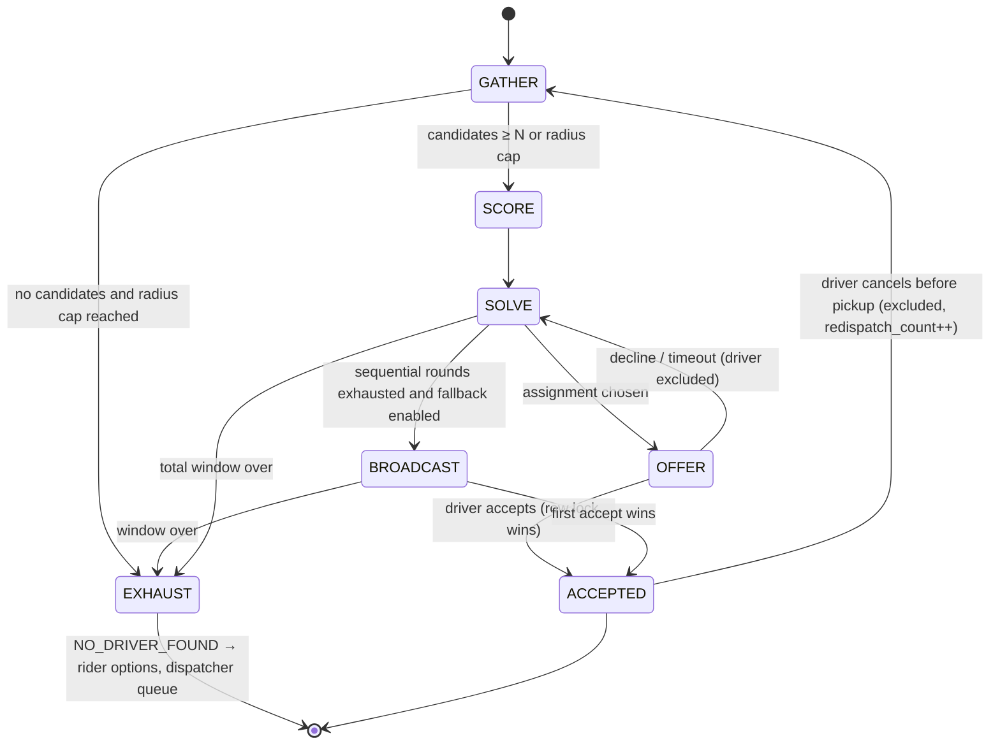

# 02 · Booking and dispatch engine

> Design of the Platform's trip booking flow and driver-suggestion (matching) engine. Follows the principles Uber publishes for its marketplace, sized for a market of hundreds to a few thousand online drivers. Songa's engine (`00-songa-system-scan.md` §3, Doc3 audit) is reference only. Decision record: `adr/0004-dispatch-model.md`.

Variables: see `01-platform-redesign.md`. All knobs below are per **service** and per **region/time-of-day**, stored in `matching_configs` / `service.dispatch` and editable live.

## 1. Goals

| Goal | Measure |
|---|---|
| Fast matches | p50 time-to-accept < 30 s (taxi), < 90 s (hauling) |
| Right driver, not nearest driver | ETA-at-match, cancel-after-accept rate |
| High acceptance | offer acceptance rate > 70 % |
| Few unfulfilled requests | NO_DRIVER_FOUND rate per hex/hour |
| Fair supply | offers per driver spread; idle time distribution |
| Everything explainable | every decision logged in `match_decisions` |

## 2. Principles borrowed from Uber, and how they land here

| Uber practice | Here |
|---|---|
| H3 hexagonal indexing at several resolutions | res 9 presence and matching, res 7 surge/heat, res 5 analytics (Uber's C library via `h3-go`) |
| ETA-based matching rather than straight-line distance | H3 pre-filter, then road ETA for the top-K from a `(cell, cell, hour-bucket)` cache backed by the routing provider |
| Batched matching: hold requests a few seconds and solve all open requests × candidates together | 3 s (taxi) / 5 s (hauling) batch; min-cost bipartite assignment; a batch of one degenerates to best-driver pick |
| Sequential offer to the assigned driver with a short window; re-solve on decline | 12–20 s offers; decline or timeout feeds the next solve |
| Broadcast where supply is thin | explicit fallback mode after N sequential rounds, or always-on for configured regions/hours |
| Forward dispatch (trip chaining) | drivers predicted free within 5 min are candidates with a time penalty |
| Acceptance and cancellation probability in the objective | heuristics first, learned models once `match_decisions` has data |
| Per-hex dynamic pricing with neighbour smoothing | surge per res-7 cell, k=1 smoothing, clamp 1.0–2.0, locked at quote |
| Driver positioning guidance | res-7 demand heat and "hot zones" in the driver app |
| Durable long-running workflows (Cadence/Temporal) | the same shape as a River saga with persisted state and timers; Temporal itself is too heavy for the footprint target |
| Marketplace metrics + experimentation | per-hex/hour metrics; dispatch parameters are config flags for A/B by region |

## 3. Supply model (presence)

```
PUT /v1/driver/presence {online:true, lat, lng, vehicle_id}
  → HSET presence:{driver}  lat lng h3 heading speed acc at state(IDLE|OFFERED|ON_TRIP) trip classes services rating tier vehicle
    EXPIRE presence:{driver} 2×staleness
  → ZADD cell:{h3_r9} <now> {driver}        (ZREM from the previous cell on cell change)
  → SADD cells:active {h3_r9}
Every location frame refreshes the hash and the ZSET score.
Fresh drivers in a cell = ZRANGEBYSCORE cell:{h3} (now − staleness) +inf        staleness default 120 s
GC every 30 s: ZREMRANGEBYSCORE on cells in cells:active; expired hash = offline.
```
- "Online" has exactly one definition: a fresh presence record. There is no DB flag to drift from it; online/offline transitions are recorded as events for analytics only.
- A driver whose pings stop for 60 s while the socket is open receives `presence.stale` so the app can warn "riders cannot see you".
- The driver's state also carries `free_at` (predicted) while ON_TRIP, for forward dispatch.
- Heartbeat contract for the driver app: a location frame at least every 25 s when idle, every 5 s or 1 m when moving; HTTP batch fallback when the socket is down.

## 4. Booking flow

```mermaid
sequenceDiagram
  participant R as Rider app
  participant API as platform api
  participant Q as River (worker)
  participant D as Driver app
  R->>API: POST /v1/quotes {service, stops, attributes}
  API-->>R: options per vehicle class (fare, eta, availability), quote_id, expires_at
  R->>API: POST /v1/trips {quote_id, class, payment_method} Idempotency-Key
  API->>API: tx: insert trip REQUESTED + trip_events + River dispatch job
  API-->>R: 201 trip (seq 1)
  Q->>Q: DispatchSaga: gather → score → solve → offer
  Q-->>D: WS offer.new (+ FCM data push)
  D->>API: POST /v1/driver/offers/{id}/accept
  API->>API: tx: SELECT trip FOR UPDATE; status OFFERED→ACCEPTED; siblings SUPERSEDED
  API-->>R: WS trip.updated (ACCEPTED, driver, vehicle, eta)
```

Rules that make booking robust:
1. **Quote** validates `attributes` against the service's RequestSchema, prices every eligible vehicle class, includes ETA-to-pickup from fresh supply and `available` counts, and stores a snapshot (tariff version, surge, route). Expiry 3 min; an expired quote is re-quoted and the difference shown.
2. **One active trip per rider** is a partial unique index on `trips (rider_id) WHERE status IN (active set)`, not an application check.
3. **Idempotency-Key** is mandatory on `POST /trips`, accept, transitions and cancel; same key + different body → `409 IDEMPOTENCY_MISMATCH`.
4. The dispatch job is inserted **in the same transaction** as the trip row (River `InsertTx`), so there is no "dispatch after commit" race and no lost dispatch.
5. Rider state arrives as `trip.updated` frames with sequence numbers; `GET /trips/{id}/events?after_seq=` replays after reconnect.
6. On `NO_DRIVER_FOUND` the rider is offered: keep searching (extends the window), widen vehicle class, schedule for later, or contact support (dispatcher queue).
7. Destination change mid-trip creates a new stop version and re-prices with the actual-distance rule (route estimate vs GPS, +25 % detour cap).
8. **Scheduled** trips (`scheduled_for`) start their saga at lead time per service, send reminders, and become `EXPIRED` if never dispatched.

## 5. DispatchSaga (one per request; state persisted; timers are River jobs)



### 5.1 GATHER — candidate search
- Resolve config for (service, region, hour): `radius_km`, `staleness_s`, `min_candidates`, `batch_s`, `offer_s`, `max_rounds`, `broadcast_mode`, `forward_dispatch_min`.
- H3 `gridDisk(pickup_cell, k)` for k ∈ {1, 2, 4, 8, 16, 32}; union of fresh members of each `cell:{h3}`; stop when ≥ `min_candidates × 2` or the radius cap.
- Hard filters: fresh; `state = IDLE` or forward-dispatchable; KYC approved; not on hold or suspended; eligible for (service, vehicle class); plugin filter (capacity ≥ weight/volume, cargo compatibility, licence category); not in `excluded` for this trip; not holding another outstanding offer (`offer:{driver}` lock).

### 5.2 SCORE — cost function, versioned
```
cost(d, r) = w_eta · ETA(d → pickup_r)                     road ETA, cached per (cell_d, cell_r, hour)
           + w_acc · (1 − P_accept(d, r))                  acceptance probability
           + w_can · P_cancel(d)                           cancel-after-accept probability
           + w_fair · fairness(d)                          recent offers / idle time (Redis ZSET)
           + w_fwd · forward_penalty(d)                    minutes until predicted free, if ON_TRIP
           + w_fit · capacity_fit(d, r)                    hauling: prefer the smallest class that fits
```
- **v0** (phase 1, parity): Songa's scoring ported verbatim (distance, rating soft tier, level, experience, bearing, fairness) and golden-tested, used only until the ETA cache exists.
- **v1** (pilot): ETA from cache, acceptance rate as `P_accept`, fairness, capacity fit.
- **v2** (after ~10k matches): logistic `P_accept(d, r)` and `P_cancel(d)` trained from `match_decisions`; per-hex/hour ETA correction factors.

### 5.3 SOLVE — batched assignment
- Every `batch_s`, take all open requests in the region and their candidate sets; build the cost matrix; solve min-cost bipartite assignment (Hungarian for ≤ 100×100; min-cost flow beyond). Requests without a feasible candidate stay open for the next batch.
- Tie-break on fairness. A request that has already been declined by k drivers gets a priority boost so it does not starve.

### 5.4 OFFER — sequential by default
- Insert `trip_assignments (trip, driver, round, cost, offered_at, expires_at = now + offer_s, outcome = OFFERED)`; `SET NX EX offer:{driver} trip_id offer_s`; send `offer.new` over WS **and** an FCM high-priority data push; schedule River `offer_timeout(trip, round)` as a unique job.
- Accept (`POST /v1/driver/offers/{id}/accept`): one transaction — `SELECT trips … FOR UPDATE`; require status ∈ {REQUESTED, OFFERED} and this assignment OFFERED and not expired → trip ACCEPTED with driver + vehicle; sibling assignments SUPERSEDED; `trip_events` + hooks; commit → `trip.updated` to rider, `offer.withdrawn` to any other holder, `DEL offer:{driver}`. A late accept gets `409 OFFER_TAKEN`.
- Decline or timeout → assignment REJECTED / TIMED_OUT, driver added to `excluded`, back to SOLVE.

### 5.5 BROADCAST — thin-supply fallback
- After `max_sequential_rounds` (default 2) or when `broadcast_mode = always` for the (region, hour): offer to the top `broadcast_size` (default 3) simultaneously for `offer_s`; first accept wins by the same row lock; others get `offer.withdrawn`.

### 5.6 EXHAUST and RECOVER
- Total window per service (taxi 90 s, hauling 180 s, configurable) → `NO_DRIVER_FOUND`; rider options; request appears in the **dispatcher queue** for manual assignment (`POST /v1/admin/trips/{id}/assign {driver_id, reason, force}`; `force=true` sets ACCEPTED directly for phone-arranged jobs; both audited).
- Driver cancels after accept and before pickup: assignment CANCELLED, driver excluded, trip back to REQUESTED, rider gets `trip.redispatching`, saga restarts immediately; the fraud module records the cancellation.
- A 30 s reaper closes any REQUESTED/OFFERED trip older than its window in case a saga was lost.

## 6. Per-service defaults

| Knob | Taxi | Cargo hauling | Recovery | Water |
|---|---|---|---|---|
| batch_s | 3 | 5 | 5 | 5 |
| offer_s | 12 | 20 | 30 | 30 |
| radius_km cap | 5 | 30 | 40 | 30 |
| min_candidates | 3 | 3 | 2 | 2 |
| sequential rounds before broadcast | 3 | 2 | 1 | 2 |
| broadcast_size | 2 | 3 | 3 | 3 |
| total window s | 90 | 180 | 240 | 180 |
| forward_dispatch_min | 3 | 5 | 0 | 5 |
| staleness_s | 120 | 120 | 120 | 120 |

Region/time overrides (e.g. night, upcountry) sit on top of these.

## 7. Data

Postgres: `trips` (status, `redispatch_count`, `dispatch_window_ends_at`), `trip_assignments` (round, cost, offered/expires/responded, outcome OFFERED|ACCEPTED|REJECTED|TIMED_OUT|SUPERSEDED|CANCELLED, source AUTO|MANUAL, assigned_by), `match_decisions` (trip, batch_id, candidates jsonb [driver, cost components, eta], chosen, outcome, solver_ms), `trip_events` (seq log; also the WS replay source), `matching_configs` + overrides, `eta_cache` (optional persistence of the Redis cache for warm starts).

Redis: `presence:{driver}` hash (TTL), `cell:{h3_r9}` zset, `cells:active` set, `offer:{driver}` string NX, `dispatch:{trip}` hash (round, excluded, candidates; TTL 30 min), `fair:{region}` zset (recent offers per driver), `eta:{cell_a}:{cell_b}:{hour}` string (TTL 24 h), `demand:{h3_r7}:{5-min}` counters (surge), `ws:{topic}` pub/sub.

## 8. Realtime protocol (dispatch-relevant frames)

Client → server: `auth` (first frame), `resume {trips:{id: last_seq}}`, `location {lat, lng, heading, speed, acc, at, trip?}`, `ack`.
Server → client: `offer.new {assignment_id, trip summary, fare_estimate, pickup, dropoff, eta_s, distance_km, expires_at}`, `offer.withdrawn`, `trip.updated {status, allowed_transitions[], driver?, vehicle?, eta, phase timestamps}`, `trip.driver_location`, `trip.redispatching`, `trip.no_driver`, `presence.stale`.
Heartbeat: server ping 20 s, close after two misses; client reconnects with backoff 1→30 s and resumes by sequence number. Delivery is at-least-once; frames carry full status so re-rendering is idempotent.

## 9. Metrics and experimentation

Per service × region × hour: requests, matched, time-to-first-offer, time-to-accept, offers per match, acceptance rate, ETA-at-match (predicted vs actual arrival), cancel-after-accept, NO_DRIVER_FOUND rate, forward-dispatch share, broadcast share, solver latency. Dispatch knobs are config flags, so an A/B by region is a config change; `match_decisions` stores the config version used.

## 10. Failure modes

| Failure | Behaviour |
|---|---|
| Redis lost | presence rebuilds from pings within 25 s; open offers expire naturally; trips are in Postgres |
| Worker crash mid-saga | River retries the job; saga state is in `dispatch:{trip}` and `trip_assignments`; the reaper is the backstop |
| Two instances accept the same offer | the trip row lock decides; the loser gets `409 OFFER_TAKEN` |
| Routing provider down | ETA falls back to haversine × per-region speed factor; flagged in `match_decisions` |
| Driver socket dead | FCM data push carries the offer; HTTP accept works without the socket |
| Rider socket dead | `GET /trips/{id}/events?after_seq` replay on reconnect |

## 11. Test plan

Unit: cost function v0 golden tests against exported Songa cases; solver on hand-built matrices; FSM transition table. Integration (testcontainers): two requests, five drivers, assert assignment, offer timeout, decline → re-solve, broadcast fallback, driver cancel → redispatch, accept race across two API instances sharing one Redis. Load (k6): 600 drivers pinging every 10 s + 1 request/s; p95 API < 150 ms, solver < 50 ms per batch, RAM < 400 MB.
