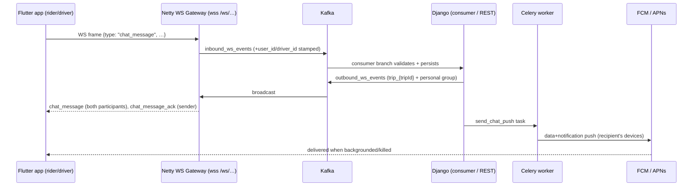

# Trip Chat — Flutter Integration Guide (Rider & Driver apps)

Backend support for in-trip chat between the rider and the matched driver is live. This
document is the complete contract for both apps: WebSocket frames, REST endpoints, FCM
push, quick replies, typing indicator, and the client rules that make delivery reliable.

**Architecture recap** (matches `WEBSOCKET_DRIVER_ALIGNMENT.md`):



- **Foreground / live**: messages arrive over the existing WebSocket in real time.
- **Background / offline**: the same message arrives as an FCM push (APNs on iOS via FCM,
  no extra cost). The app dedups the two by `message_id`.

---

## 1. Chat lifecycle

| Trip status | Send | Read history |
|---|---|---|
| `REQUESTED`, `NO_DRIVER_FOUND` | ❌ (no driver yet) | ❌ (no messages exist) |
| `ACCEPTED`, `EN_ROUTE_TO_PICKUP`, `EN_ROUTE_TO_DESTINATION`, `LOADING`, `STARTED`, `UNLOADING` | ✅ | ✅ |
| `COMPLETED`, `CANCELED_BY_*` | ❌ (400 / `chat_error`) | ✅ forever (participants only) |

Show the chat entry point as soon as the trip is accepted. After the trip ends, keep
history viewable (read-only) from trip details.

## 2. WebSocket connection

Nothing new: connect exactly as you do today.

- URL: `wss://songa.kalen.co.tz/ws/trips/{tripId}/?token=<JWT access token>`
- On connect the gateway auto-joins you to `trip_{tripId}`, `user_{userId}` and (drivers)
  `driver_{driverId}`. Chat frames are delivered to **both** the trip group and the
  recipient's personal group — so even a driver connected only to
  `/ws/driver/location/` still receives chat messages. Dedup by `message_id`.

## 3. WebSocket frames

### 3.1 Client → server

**Send a message** (either give `content`, or `template_key` for a quick reply):

```json
{
  "type": "chat_message",
  "trip_id": "6949ad16-1849-480d-a160-7284b910bc70",
  "client_message_id": "c3f1e0aa-9b1e-4a94-8a3c-2f6f3f1c9d10",
  "content": "I'm at the gate",
  "template_key": null,
  "lang": "en"
}
```

| Field | Required | Notes |
|---|---|---|
| `type` | ✅ | literally `"chat_message"` |
| `trip_id` | ✅ | the trip UUID (`trip_id`, not the numeric id) |
| `client_message_id` | ✅ | **UUID generated by the app per send attempt-group** — reuse the same value on retries; the server dedups on it |
| `content` | ✅ unless `template_key` | 1–2000 chars, plain text |
| `template_key` | optional | quick-reply key; server resolves the localized text and **ignores** `content` |
| `lang` | optional | `en` (default) or `sw` — language used to resolve `template_key` |

**Typing indicator** (throttle to at most 1 frame / 3 s while the user types):

```json
{ "type": "chat_typing", "trip_id": "6949ad16-…" }
```

**Mark read** (when the chat screen is open/visible):

```json
{ "type": "chat_read", "trip_id": "6949ad16-…", "up_to_message_id": null }
```

`up_to_message_id` (optional) limits the mark to messages at or before that message.

### 3.2 Server → client

**Incoming / echoed message** (sent to the trip group + recipient's personal group; the
sender receives it too — treat the echo as delivery confirmation):

```json
{
  "type": "chat_message",
  "trip_id": "6949ad16-…",
  "message_id": "0d9b3a52-…",
  "client_message_id": "c3f1e0aa-…",
  "sender_id": 42,
  "sender_role": "DRIVER",
  "sender_name": "John D",
  "content": "I'm here.",
  "template_key": "im_here",
  "created_at": "2026-08-14T10:00:00.123456+00:00"
}
```

**Ack** (to the sender's personal group only; re-sent on dedup replays):

```json
{
  "type": "chat_message_ack",
  "trip_id": "6949ad16-…",
  "client_message_id": "c3f1e0aa-…",
  "message_id": "0d9b3a52-…",
  "created_at": "2026-08-14T10:00:00.123456+00:00",
  "status": "ok"
}
```

**Error** (to the sender's personal group only):

```json
{
  "type": "chat_error",
  "original_type": "chat_message",
  "trip_id": "6949ad16-…",
  "client_message_id": "c3f1e0aa-…",
  "error": "Chat is not open for this trip (status COMPLETED)."
}
```

Error strings you should handle specially: chat closed (`Chat is not open…`) → disable the
composer; rate limit (`Too many messages…`) → brief cooldown toast.

**Read receipt** (to the trip group; `reader_id` is the user who read):

```json
{
  "type": "chat_read",
  "trip_id": "6949ad16-…",
  "reader_id": 7,
  "up_to_message_id": null,
  "read_at": "2026-08-14T10:00:05+00:00"
}
```

If `reader_id` is the **other** participant, flip your sent bubbles to "read".

**Typing** (to the trip group; ignore frames where `sender_id` is yourself; show the
indicator for ~4 s after the last frame):

```json
{ "type": "chat_typing", "trip_id": "6949ad16-…", "sender_id": 42 }
```

## 4. REST API

Base: `https://songa.kalen.co.tz/api/messaging/` — all endpoints need
`Authorization: Bearer <JWT>`. Errors are `{"error": "…"}` with 400/401/403/404/429.

### 4.1 `GET /api/messaging/messages/?trip_id=<uuid>&page=1&page_size=30`

Paginated history, **newest first** (reverse client-side for display). Max `page_size` 100.

```json
{
  "count": 42,
  "next": "…?trip_id=…&page=2",
  "previous": null,
  "results": [
    {
      "id": "0d9b3a52-…", "trip_id": "6949ad16-…",
      "sender": 42, "sender_name": "John D", "sender_role": "DRIVER",
      "client_message_id": "c3f1e0aa-…", "content": "I'm here.",
      "template_key": "im_here",
      "created_at": "…", "delivered_at": "…", "read_at": null
    }
  ]
}
```

### 4.2 `POST /api/messaging/messages/` — fallback send

Body: `{ "trip_id", "content", "client_message_id", "template_key"?, "lang"? }` — same
semantics as the WS frame. **201** on create, **200** when the `client_message_id` was
already stored (safe retry). Use only when the WS send didn't ack (see §7); the recipient
still gets the WS broadcast + push.

### 4.3 `POST /api/messaging/messages/read/`

Body: `{ "trip_id", "up_to_message_id"? }` → `{ "marked_read": 2 }`. REST twin of the
`chat_read` frame — use it on chat-screen open when the socket isn't up yet.

### 4.4 `GET /api/messaging/messages/unread-count/`

- With `?trip_id=<uuid>` → `{ "trip_id": "…", "unread": 3 }`
- Without → `{ "unread": 5 }` across your active trips. Call on app resume to badge the
  chat icon.

### 4.5 `GET /api/messaging/quick-replies/?lang=en|sw`

Templates for **your role** (driver vs rider inferred from the account):

```json
{ "results": [
  { "key": "im_here", "text": "I'm here.", "sort_order": 0 },
  { "key": "ok", "text": "OK.", "sort_order": 10 }
] }
```

Render as tap chips above the composer. On tap, send with `template_key` (and your
current `lang`) — you may omit `content`. Fetch once per session per language; keys are
stable, texts are admin-editable.

### 4.6 `POST /api/messaging/devices/` — FCM token registration

```json
{ "token": "<fcm token>", "platform": "ANDROID" | "IOS",
  "app": "RIDER" | "DRIVER", "lang": "en" | "sw" }
```

Call on every app start and on FCM `onTokenRefresh`. Upsert-by-token (safe to repeat;
re-registering after account switch moves the token). `lang` localizes push text.

`DELETE /api/messaging/devices/` with `{ "token": "…" }` on logout.

## 5. FCM push

Every chat message triggers a push to the recipient's registered devices (skipped if it
was already read). The message is **notification + data**:

- notification: `title` = sender name, `body` = message text (truncated to 100 chars)
- collapse: `collapse_key` / `apns-collapse-id` = `chat_trip_<tripId>` — a burst of
  messages shows as one notification per trip
- data (all values are strings):

```json
{
  "type": "chat_message",
  "trip_id": "6949ad16-…",
  "message_id": "0d9b3a52-…",
  "client_message_id": "c3f1e0aa-…",
  "sender_id": "42",
  "sender_role": "DRIVER",
  "created_at": "2026-08-14T10:00:00+00:00"
}
```

Client rules:

1. **Dedup**: if `message_id` was already received over WS, ignore the push (when the
   app is foregrounded with the chat socket up, suppress the notification entirely).
2. **Deep link**: tapping opens the chat screen for `data.trip_id`.
3. Firebase setup (`google-services.json` / `GoogleService-Info.plist`) comes from the
   same Firebase project as the backend's service account — ask backend for the project.

## 6. Client_message_id & optimistic UI

- Generate a UUID v4 **when the user hits send**; keep it constant across all retries of
  that message (WS and REST). The server's unique constraint makes any retry safe.
- Render the bubble immediately in a "sending" state keyed by `client_message_id`.
- On `chat_message_ack` (or REST 201/200) attach the server `message_id` and flip to
  "sent". On the group echo/`chat_read`, flip to "delivered"/"read".

## 7. Retry matrix

| Situation | Action |
|---|---|
| WS open, no ack within 5 s | Resend same frame once; still nothing → POST REST with same `client_message_id` |
| WS closed / connecting | POST REST directly |
| REST also fails | Keep bubble "failed", offer tap-to-retry (same `client_message_id`) |
| WS reconnects | **Refetch history** for the open trip (gateway group state is in-memory; anything broadcast while you were down is only in history), then send `chat_read` |
| `chat_error` "Chat is not open…" | Disable composer, keep history visible |
| 429 / rate-limit `chat_error` | Disable send for ~10 s, show "sending too fast" |

## 8. Environments

| Env | REST base | WS base |
|---|---|---|
| Production | `https://songa.kalen.co.tz` | `wss://songa.kalen.co.tz` |
| Local compose | `http://localhost` | `ws://localhost` |

Backend ops note: FCM requires `FCM_ENABLED=True` and the Firebase service-account JSON at
`secrets/firebase-service-account.json` (see docker-compose; gitignored). With FCM off,
chat still works live over WS — only background push is skipped.
