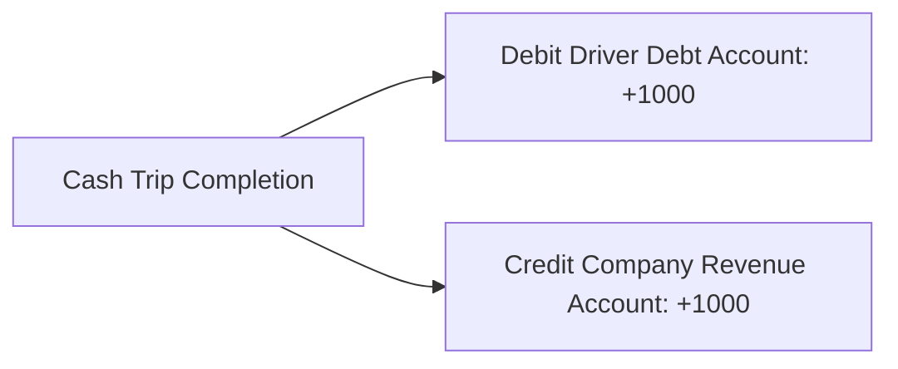
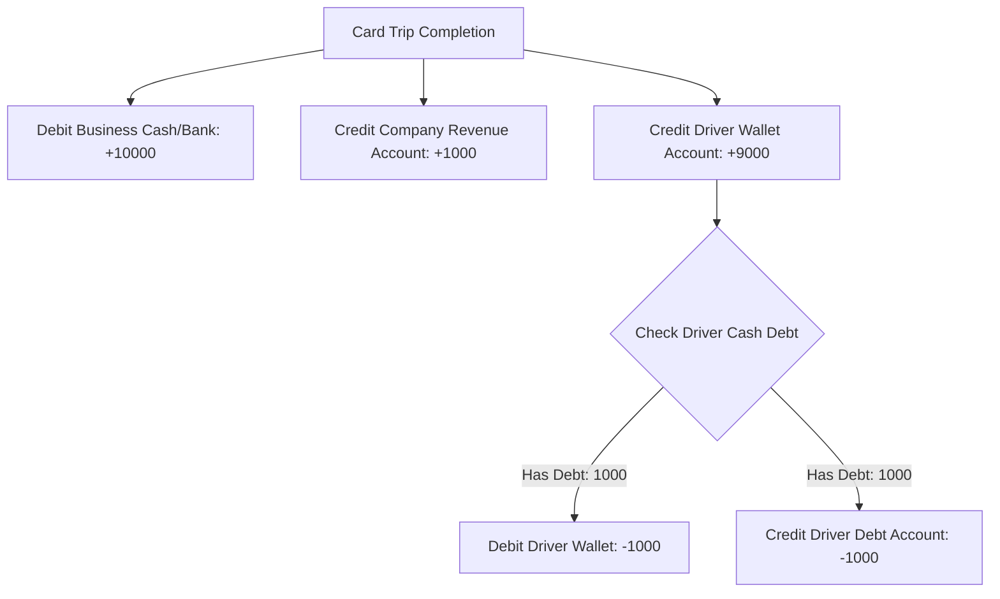

# Cryptographic Double-Entry Ledger & Payment System Design

## 1. Executive Summary

The Songa payment system coordinates trip fares, platform commissions, driver wallets, settlements, and automated account holds. The backend is powered by a production-grade **Cryptographic Double-Entry Ledger Engine** that replaces traditional flat-balance tracking. By modeling all financial activities as balanced debit and credit entries across dedicated sub-ledgers, the platform ensures absolute financial audibility, append-only immutability, and 100% backward-compatibility for active mobile clients.

---

## 2. Core Bookkeeping Concepts

### 2.1. Double-Entry Ledger Architecture
Every financial event is modeled as a logical `Transaction` comprised of balanced `LedgerEntry` records. The total amount debited must precisely equal the total amount credited across all impacted accounts.

* **Asset Accounts (`ASSET`)**: Represent resources owned or owed to the platform.
  * *Driver Debt Account (`Driver_{id}_Debt`)*: Represents cash commission the driver owes the platform.
  * *Business Cash/Bank Account (`Business Cash/Bank`)*: Represents platform bank funds.
* **Liability Accounts (`LIABILITY`)**: Represent resources the platform owes to external entities.
  * *Driver Wallet Account (`Driver_{id}_Wallet`)*: Represents card earnings the platform owes the driver.
* **Revenue Accounts (`REVENUE`)**: Represent platform earnings.
  * *Service Charge Revenue (`Service Charge Revenue`)*: Cumulative commissions earned.

---

## 3. Cryptographic Chain & Immutability

To guarantee tamper-proof financial audit trails, all transactional records are locked and secured cryptographically:

### 3.1. Append-Only Enforcement
The `LedgerEntry` model strictly blocks `UPDATE` and `DELETE` queries at the application level. If any update or delete operation is attempted, a validation constraint immediately throws a structured `ValidationError`:
* `Prevented UPDATE`: "Immutable Ledger: Existing records cannot be updated."
* `Prevented DELETE`: "Immutable Ledger: Deletion is strictly prohibited."

### 3.2. Sequential SHA-256 Global Chaining
All entries are bound sequentially using SHA-256 cryptographic hashes. When creating a new `LedgerEntry`, the database executes an atomic block with row-level locks (`select_for_update`) to fetch the globally last record and bind the new block to its preceding entry:

$$\text{Data} = \text{previous\_hash} - \text{transaction\_id} - \text{account\_id} - \text{entry\_type} - \text{amount} - \text{timestamp}$$

$$\text{current\_hash} = \text{SHA256}(\text{Data})$$

* **Genesis Pointer**: The absolute first record in the global database utilizes a hardcoded genesis pointer:
  `"GENESIS_00000000000000000000000000000000000000000000000000000000"`

---

## 4. Transaction Flow Lifecycles

### 4.1. Cash Trip Flow (Debt Generation)
Under cash payments, the driver collects the entire trip fare directly from the rider. The platform commission (default: 10%) is recorded as driver debt:

* **Calculation**:
  $$\text{Fare} = 10,000 \text{ TZS}$$
  $$\text{Platform Commission (10\%)} = 1,000 \text{ TZS}$$
  $$\text{Driver Share} = 9,000 \text{ TZS}$$
* **Ledger Postings**:
  1. **Debit** `Driver_{id}_Debt` account by $1,000 \text{ TZS}$ (increasing the driver's outstanding debt).
  2. **Credit** `Service Charge Revenue` account by $1,000 \text{ TZS}$ (increasing platform revenue).
* **State Updates**:
  * The local driver wallet cache registers `debt = 1,000 TZS`.



### 4.2. Card/Mobile Trip Flow with Real-Time Auto-Offset
Under card or mobile money payments, the platform collects the entire fare up-front. The driver's net share is computed, and the system **automatically checks for and offsets** pre-existing driver cash debts before transferring earnings to the wallet:

* **Scenario**: Card trip fare is $10,000 \text{ TZS}$ (90% driver share = $9,000 \text{ TZS}$). The driver has an existing cash debt of $1,000 \text{ TZS}$.
* **Ledger Postings**:
  1. **Debit** `Business Cash/Bank` by $10,000 \text{ TZS}$ (platform collects the fare).
  2. **Credit** `Service Charge Revenue` by $1,000 \text{ TZS}$ (app earns its 10% commission).
  3. **Credit** `Driver_{id}_Wallet` by $9,000 \text{ TZS}$ (allocating driver share).
  4. **Auto-Offset Clearing**:
     * **Debit** `Driver_{id}_Wallet` by $1,000 \text{ TZS}$ (withdrawing from wallet to clear debt).
     * **Credit** `Driver_{id}_Debt` by $1,000 \text{ TZS}$ (reducing driver debt to zero).
* **State Updates**:
  * Wallet balance cache: `balance = 8,000 TZS`, `debt = 0 TZS`.



### 4.3. Direct Settlement Flow
When a driver directly pays the business (via bank deposit or mobile money cash-in) to settle outstanding debts, the transaction goes through a three-stage verification lifecycle:

1. **Initiate (`PENDING`)**: Driver submits receipt. Creates a `Settlement` record.
2. **Verify (`VERIFIED`)**: Administrator checks bank/cash receipt and flags receipt as verified.
3. **Complete (`COMPLETED`)**: Double-entry ledger postings clear the debt:
   * **Debit** `Business Cash/Bank` account (recording received funds).
   * **Credit** `Driver_{id}_Debt` account (clearing driver outstanding debt).
   * Cash debt cache is set to `0.00` and `last_settlement_date` is updated.

---

## 5. Account Hold Policy & Safety Limits

To mitigate the risk of driver defaults on cash commissions, the system automates safety limits on matching:

### 5.1. Hold Triggers
A driver's account is automatically set to **ON HOLD** (blocking new trip assignments) if either condition is met:
1. **Critical Debt Threshold**: Outstanding `debt` equals or exceeds the threshold (default: $5,000 \text{ TZS}$, customizable via `ServiceChargeSetting`).
2. **Unsettled Debt Duration**: Outstanding `debt > 0` and no completed settlement has occurred in the past $7 \text{ days}$.

### 5.2. Unhold Conditions
The hold is instantly removed when:
* Outstanding `debt` is reduced below the threshold AND
* The driver has performed a successful settlement within $7 \text{ days}$ (or outstanding `debt` is exactly $0.00$).

---

## 6. API Compatibility & Django Admin

### 6.1. REST API Backward-Compatibility
Mobile applications (both Rider and Driver clients) expect specific, flat, and consistent payload structures. To prevent breaking active apps, the system utilizes a read-only serializer adapter (`LedgerSerializer`) which dynamically flattens the multi-ledger model fields into legacy contract keys:

```json
{
  "ledger_id": "LED-45",
  "driver": "USER-255799999999",
  "trip": "ca415a91-f650-4a5b-9b92-4f3dba40c554",
  "amount": 1000.00,
  "transaction_type": "credit",
  "description": "Direct Settlement - BANK_TRANSFER - REF-123",
  "balance": 0.00,
  "created_at": "2026-05-22T04:04:02.039Z"
}
```

### 6.2. Django Admin Control Center
The administration console integrates powerful tools for ledger monitoring and settlement authorization:
* **Pruned Obsolete Tables**: Legacy flat ledger models are removed from list views.
* **`LedgerEntry` Inspector**: Displays truncated SHA-256 hashes, running balances, links to parent transaction blocks, and is strictly read-only to preserve security.
* **Bulk Admin Actions**: Registers direct actions in `Settlement` lists enabling administrators to bulk-verify and bulk-complete transactions safely with automatic double-entry bookings.
* **Color-Coded Driver Wallets**: Colorizes driver financial balances (bold green for positive balances, bold red for debts).
