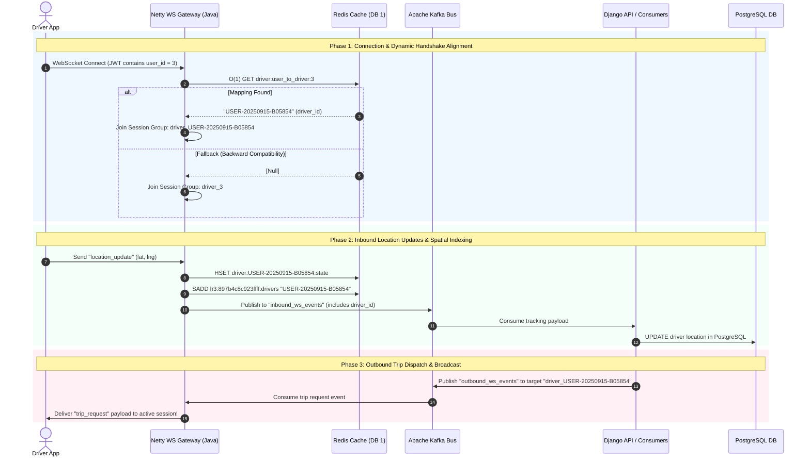

# WebSocket Driver Mismatch Resolution Architecture

This document describes the architectural mismatch between the **Java Netty WebSocket Gateway** and the **Django Backend** regarding driver routing keys, and details the high-performance Redis alignment solution.

---

## 🏗️ System Structural Architecture Flowchart

The diagram below shows the static topology of all components and the numerical step-by-step data flow through the microservice ecosystem.

```mermaid
graph TD
    %% Define Styles
    classDef client fill:#f9f,stroke:#333,stroke-width:2px;
    classDef gateway fill:#bbf,stroke:#333,stroke-width:2px;
    classDef cache fill:#bfb,stroke:#333,stroke-width:2px;
    classDef broker fill:#fdb,stroke:#333,stroke-width:2px;
    classDef backend fill:#fbf,stroke:#333,stroke-width:2px;
    classDef db fill:#ddd,stroke:#333,stroke-width:2px;

    %% Components
    Driver["📱 Driver Mobile App"]:::client
    Rider["📱 Rider Mobile App"]:::client
    Netty["⚡ Java Netty WS Gateway"]:::gateway
    Redis[("💾 Redis Cache (DB 1)<br/>• h3:&lt;hex&gt;:drivers<br/>• driver:&lt;id&gt;:state<br/>• driver:user_to_driver:&lt;uid&gt;")]:::cache
    Kafka{{"📣 Apache Kafka Broker<br/>• inbound_ws_events<br/>• outbound_ws_events"}}:::broker
    Django["🐍 Django Backend & Consumers"]:::backend
    Postgres[("🐘 PostgreSQL Source-of-Truth")]:::db

    %% Connections & Flows
    Driver == "1. WebSocket Connect (JWT user_id=3)" ==> Netty
    Rider == "5. POST RequestCarrier" ==> Django
    
    Netty -.->| "2. O(1) Get driver_id" | Redis
    Redis -.->| "3. Returns 'USER-20250915-B05854'" | Netty
    
    Netty == "4. Location Stream & Spatial Update" ==> Redis
    Netty ==>| "4. Publish Location Update" | Kafka
    
    Kafka ==>| "Consume Inbound Tracking" | Django
    Django ==>| "Bulk DB Updates" | Postgres
    
    Django ==>| "6. Publish 'trip_request' for USER-20250915-B05854" | Kafka
    Kafka ==>| "7. Consume Outbound Events" | Netty
    Netty == "8. Deliver Broadcast (driver_USER-20250915-B05854)" ==> Driver
```

---

## ⏱️ Temporal Event Sequence Diagram

The sequence below illustrates the complete lifecycle across the dynamic handshake alignment, inbound real-time location streaming, and outbound Kafka trip dispatch broadcasting.



---

## Implemented Keys & Cache Architecture

### Redis Mapping Key
*   **Format**: `driver:user_to_driver:<user_id>`
*   **Value**: `<driver_id>` (string)
*   **Expiry**: `86400 seconds` (24 hours)

### Gateway Session Groups
*   **Driver Session Group**: `driver_<driver_id>`
*   **Fallback Group**: `driver_<user_id>`

### Location State Cache
*   **State Key**: `driver:<driver_id>:state`
*   **Spatial Set Key**: `h3:<h3Index>:drivers`
